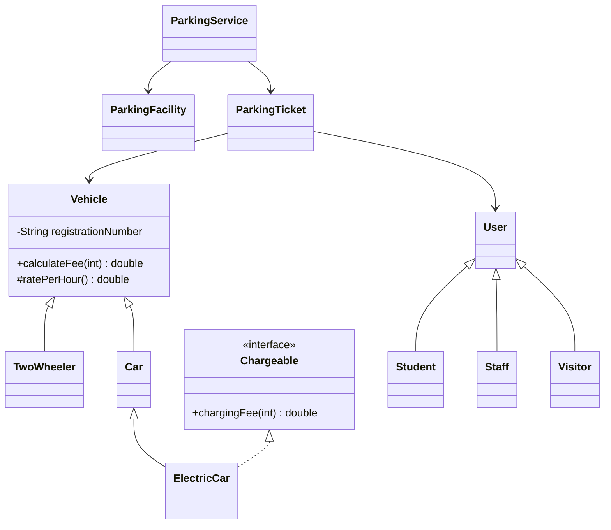

# Task 6 - Inheritance Hierarchy

The model uses hierarchical inheritance for `TwoWheeler` and `Car` from `Vehicle`, plus multilevel inheritance for `ElectricCar -> Car -> Vehicle`. Users use hierarchical inheritance from `User` to `Student`, `Staff`, and `Visitor`.

Inherited behaviour includes registration validation, equality, hashing, text conversion and fee calculation. Each subtype supplies a rate; `ElectricCar` adds `Chargeable`. `super(registrationNumber)` invokes the parent constructor. Creating `new ElectricCar("TN03C3")` executes `Vehicle` field initialisation/constructor, then `Car` constructor, then `ElectricCar` constructor.

Composition with one `Vehicle` having a `VehicleType`/rate object makes type data configurable and avoids one subclass per simple rate. Both fee calls remain `O(1)`. Inheritance adds an object of one subtype; composition adds one strategy/type reference (and possibly a shared strategy object). A new inheritance type needs a class; composition can create a new shared policy object. Task 12 therefore adopts pricing composition for changing rules.
